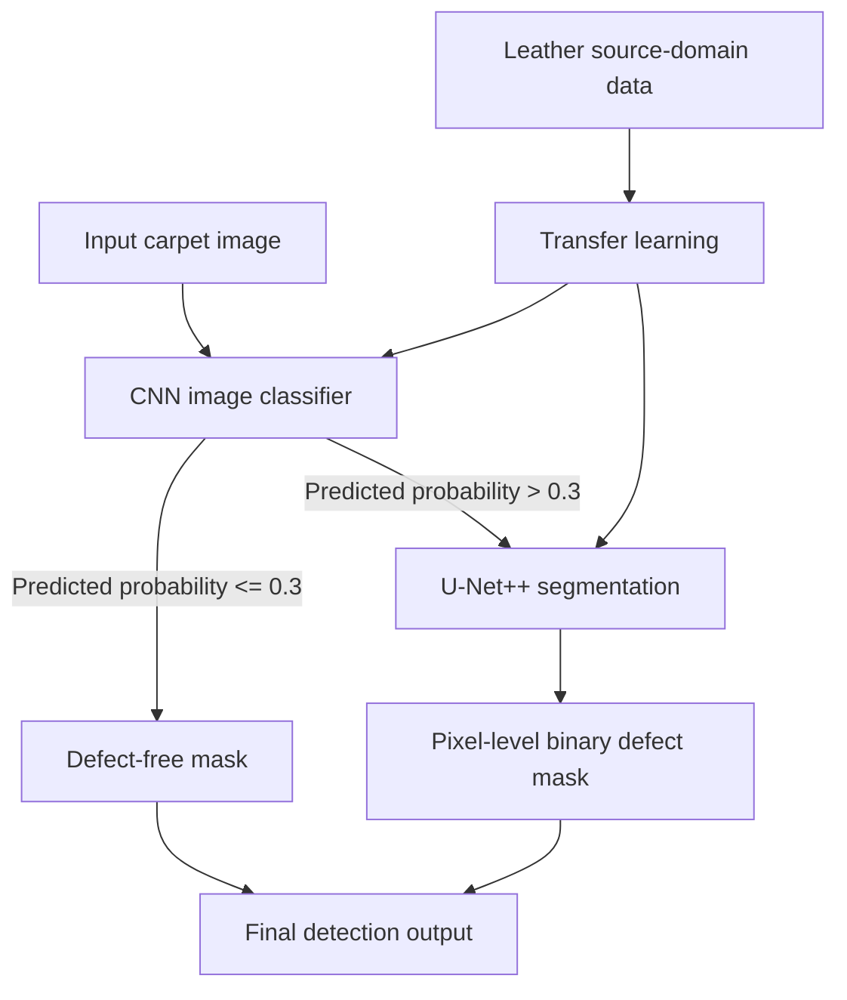

# Carpet Defect Detection with Transfer Learning

**Research paper:** *Carpet Defect Detection by Transfer Learning Combining Classification and Semantic Segmentation*  
**Publication:** 2022 6th International Conference on Universal Village (UV2022), IEEE  
**DOI:** [10.1109/UV56588.2022.10185478](https://doi.org/10.1109/UV56588.2022.10185478)  
**Repository:** [MIT-Research-Project-Defect-Image-Classification](https://github.com/Jamesxu233/MIT-Research-Project-Defect-Image-Classification)

This repository documents a computer-vision research project on industrial carpet surface-defect detection. The paper proposes a two-stage pipeline that first classifies whether an image contains a defect and then applies semantic segmentation to localize defect pixels. Transfer learning from a leather source domain to a carpet target domain is used to reduce dependence on target-domain defect samples.

> **Implementation note:** The paper describes a CNN classifier followed by a U-Net++ segmentation model. The Python files currently included in this repository snapshot implement a separate U-Net-based segmentation training/inference workflow. They do not include the paper's CNN classifier or a U-Net++ implementation. See [Implementation and Paper Alignment](docs/implementation_audit.md) before treating the uploaded scripts as a complete reproduction of the published pipeline.

## 1. Research Objective

Industrial surface defects—such as scratches, holes, and irregular texture regions—can reduce product quality and increase inspection costs. The project investigates a deep-learning approach that combines image-level screening with pixel-level defect localization, while using transfer learning to address limited labeled data in the target product domain.

### Main ideas

- **Two-stage detection:** screen images for defects first, then segment defect regions.
- **Transfer learning:** use leather images as the source domain and carpet images as the target domain.
- **Data augmentation:** the paper reports flipping, rotation, cropping, and color-shading adjustment, expanding the original dataset to 10 times its size.
- **Pixel-level evaluation:** assess segmentation using mean Intersection over Union (mIoU) and Pixel Accuracy (PA).

## 2. Methodology in the Published Paper



### Stage 1 — Image-level classification

A CNN predicts whether an input image contains defects. The paper uses a probability threshold of **0.3**: images above the threshold are forwarded to the segmentation stage, while images below it are treated as defect-free.

### Stage 2 — Semantic segmentation

The paper uses **U-Net++** to produce a binary pixel-level mask. A segmentation threshold of **0.5** is described in the paper. The output distinguishes defect pixels from background pixels.

### Transfer-learning setup

The paper uses the leather dataset as the source domain and the carpet dataset as the target domain. It compares transfer-learning and direct-training scenarios and includes U-Net as a comparison model.

## 3. Dataset

The paper uses the leather and carpet subsets of the **MVTec Anomaly Detection (MVTec AD)** dataset.

| Domain | Training images | Validation images | Test images |
|---|---:|---:|---:|
| Leather (source) | 1,935 | 277 | 553 |
| Carpet (target) | 2,012 | 288 | 575 |

The paper reports a **7:2:1** train/validation/test split and image augmentation that expands the dataset to 10 times the original size. The MVTec AD test set includes both defective and defect-free images with pixel-level ground-truth masks.

**Dataset access:** Obtain MVTec AD from its official project page and follow its terms of use. The dataset is not included in this repository.

- Official dataset page: https://www.mvtec.com/company/research/datasets/mvtec-ad

## 4. Published Results

The paper reports the following segmentation results:

| Model | Training scenario | mIoU | Pixel Accuracy |
|---|---|---:|---:|
| U-Net | Direct training | 0.436 | 0.787 |
| Proposed model | Direct training | 0.675 | 0.866 |
| U-Net | Transfer learning | 0.466 | 0.839 |
| Proposed model | Transfer learning | **0.741** | **0.889** |

Under transfer learning, the proposed method achieves the best reported performance: **mIoU = 0.741** and **PA = 0.889**. These are the paper's reported results, not a fresh reproduction result from the scripts in this repository.

The paper also reports a Dice coefficient of 0.839 for the proposed transfer-learning model in its discussion. Refer to Table II in the paper for the mIoU and PA comparison.

## 5. Code Snapshot

The uploaded Python scripts implement a U-Net segmentation workflow:

- `unet_model.py` — standard encoder-decoder U-Net with skip connections; 3 input channels and 1 output channel in the supplied configuration.
- `unet_parts.py` — convolution blocks, max-pooling downsampling, upsampling, skip concatenation, and output convolution.
- `Dice.py` — sigmoid-based Soft Dice loss.
- `dataset.py` — image/mask pair loading and torchvision transformations.
- `k_fold.py` — creates train/validation CSV files for a selected fold.
- `train.py` — trains the U-Net with 5-fold cross-validation, RMSprop, and Soft Dice loss; saves the best checkpoint per fold.
- `data_loader.py` — image preprocessing and dataset utilities, including RGB and Lab color-space transformations.
- `predict.py` — loads a saved U-Net checkpoint, predicts masks for input images, applies a threshold, and writes output PNG files.

### Code-level training settings

| Setting | Value in supplied scripts |
|---|---|
| Segmentation architecture | Standard U-Net |
| Input / output channels | 3 / 1 |
| Cross-validation | 5 folds |
| Epochs | 100 |
| Batch size | 6 |
| Optimizer | RMSprop |
| Learning rate | 0.00001 |
| Weight decay | 1e-8 |
| Momentum | 0.9 |
| Loss | Soft Dice Loss |
| Training crop size | 224 × 224 |
| Checkpoint selection | Highest reported fold validation accuracy in the script |

These settings describe the uploaded code, not the separate experimental settings in the paper.

## 6. Repository Structure

```text
MIT-Research-Project-Defect-Image-Classification/
├── README.md
├── paper/
│   └── Carpet_Defect_Detection_by_Transfer_Learning.pdf
├── src/
│   ├── Dice.py
│   ├── data_loader.py
│   ├── dataset.py
│   ├── k_fold.py
│   ├── predict.py
│   ├── train.py
│   ├── unet_model.py
│   └── unet_parts.py
├── docs/
│   └── implementation_audit.md
├── requirements.txt
└── .gitignore
```

The `data/` and `results/` folders should contain only README instructions until you have permission to publish the dataset and verified output artifacts. Do not commit the full MVTec AD dataset or large checkpoints without checking dataset terms and repository size limits.

## 7. Environment and Setup

The supplied scripts use Python libraries including PyTorch, torchvision, NumPy, Pillow, scikit-image, OpenCV, and Matplotlib.

```bash
git clone https://github.com/Jamesxu233/MIT-Research-Project-Defect-Image-Classification.git
cd MIT-Research-Project-Defect-Image-Classification

python -m venv .venv
# Windows:
.venv\Scripts\activate
# macOS / Linux:
# source .venv/bin/activate

pip install -r requirements.txt
```

The original scripts contain machine-specific absolute paths and expect CSV files containing paired image and mask paths. Before running, update those paths and prepare the data manifest to match your local dataset layout.

### Training

After correcting the data pipeline issues listed in [Implementation and Paper Alignment](docs/implementation_audit.md), configure the dataset manifest and output directory, then run:

```bash
python src/train.py
```

### Inference

Update the checkpoint path, input-image directory, and output directory in the inference configuration before running:

```bash
python src/predict.py
```

The current `predict.py` script uses hard-coded local paths; it is not yet a portable command-line interface.

## 8. Evaluation Metrics

- **Intersection over Union (IoU):** overlap between predicted and ground-truth defect regions.
- **Mean IoU (mIoU):** average IoU across evaluated classes.
- **Pixel Accuracy (PA):** proportion of correctly classified pixels.
- **Dice coefficient:** overlap measure commonly used for segmentation masks.

For a binary segmentation task:


$$
IoU = \frac{TP}{TP + FP + FN}
$$


$$
PA = \frac{TP + TN}{TP + TN + FP + FN}
$$


Use the same thresholding, mask preprocessing, and test split when comparing models. Report metrics on the held-out test set only after model selection is complete.

## 9. Limitations and Reproducibility

The paper and the supplied code snapshot are not fully aligned. In particular, the scripts supplied here do not implement the paper's complete CNN + U-Net++ two-stage architecture. The training loop also contains metric and data-transform issues that should be fixed before interpreting its accuracy values. See `docs/implementation_audit.md` for details.

## 10. Reference

T. Ren, L. Zhou, K. Xu, Y. Wang, S. Wu, Y. Gai, J. Chen, and Z. Gou, “Carpet Defect Detection by Transfer Learning Combining Classification and Semantic Segmentation,” *2022 6th International Conference on Universal Village (UV)*, 2022.  
DOI: https://doi.org/10.1109/UV56588.2022.10185478
